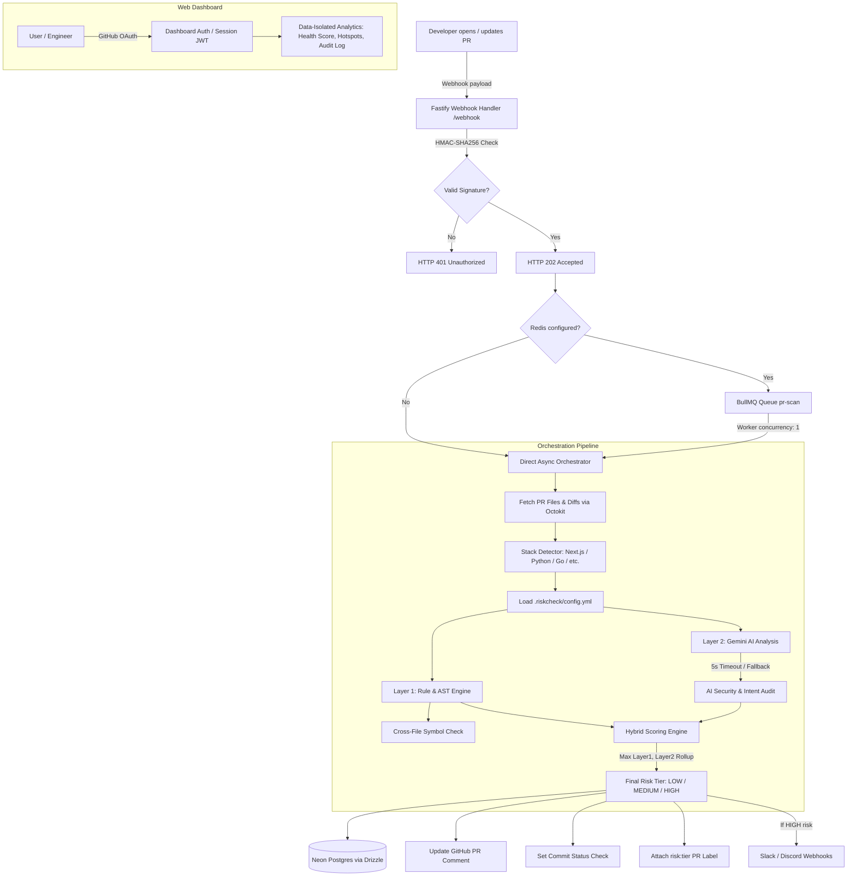

# AI Code Risk Monitor — Comprehensive Architectural & Technical Analysis

## 1. Executive Summary

**AI Code Risk Monitor** is an enterprise-grade GitHub App designed to act as an automated security gatekeeper and risk scoring monitor for Pull Requests across multiple technology stacks (Next.js/TypeScript, Node/Express, Python, Java, Go, and PHP).

It implements a **Two-Layer Hybrid Scoring Pipeline**:
1. **Layer 1 (Deterministic Rule & AST Engine)**: Fast, deterministic checks evaluating file paths, sensitive configuration changes, input validation removal (Zod, Pydantic, etc.), dangling imports, Server Action modifications, and cross-file broken export references.
2. **Layer 2 (Semantic LLM Audit via Google Gemini)**: Deep semantic reasoning that compares stated PR intent (title & description) with actual implementation diffs, identifying security holes, omitted migrations, and subtle logic regressions.

The system guarantees that **AI can only elevate risk, never suppress deterministic rule findings**. It features resilient asynchronous queue processing via BullMQ/Redis with seamless direct fallback, Neon Postgres persistence via Drizzle ORM, multi-channel alerting (GitHub PR comment/status/label + Slack/Discord), and an authenticated web dashboard with repo-level tenant isolation.

---

## 2. End-to-End Architecture Workflow

---

## 3. Component Deep Dive

### 3.1 Webhook Ingestion & Cryptography (`src/webhook/handler.ts`)
- **Raw Stream Capture**: Employs a Fastify `preParsing` hook to capture raw unparsed byte buffers before JSON decoding. This preserves exact whitespace and byte layout necessary for HMAC verification.
- **Timing-Safe HMAC Verification**: Computes `sha256=${HMAC(rawBody, GITHUB_WEBHOOK_SECRET)}` and evaluates using `crypto.timingSafeEqual` to eliminate timing attack vulnerabilities.
- **Fast Response Contract**: Sends `HTTP 202 Accepted` within milliseconds, ensuring full compliance with GitHub's 10-second webhook timeout limit.

### 3.2 Asynchronous Job Queue (`src/queue/producer.ts` & `src/queue/worker.ts`)
- **BullMQ on Redis**: Jobs are enqueued with deterministic Job IDs: `pr-${repoFullName}-${prNumber}-${headSha.slice(0, 8)}` to ensure automatic deduplication across rapid re-pushes.
- **Concurrency Rate Limiting**: Worker concurrency is set to `1` to prevent bursting against Gemini AI token-per-minute (TPM) limits.
- **Zero-Downtime Fallback**: If `REDIS_URL` is omitted, pointing to localhost, or unreachable, both producer and worker gracefully drop back to in-memory asynchronous orchestration without interrupting PR processing.

### 3.3 Stack Detection & Config Engine (`src/detector/`)
- **Heuristic Path Matching**: Inspects file patterns (e.g. `next.config.js`, `requirements.txt`, `go.mod`, `pom.xml`, `composer.json`).
- **Dynamic package.json Fallback**: If paths are ambiguous, reads `package.json` to differentiate Next.js vs. Express/Fastify.
- **Custom Config Overrides**: Parses repository `.riskcheck/config.yml` with stack-specific defaults:
  - Custom weights per signal.
  - Sensitive file paths (e.g. admin panels, payments).
  - Disabled signals.
  - Ignored file patterns (`*.lock`, `dist/**`, vendor files).

### 3.4 Layer 1 Scoring Engine (`src/scoring/`)
Deterministic analysis executes across two sub-layers:
1. **Path-Level Detectors (`path-detectors.ts`)**:
   - `auth_config_changed` (+40)
   - `middleware_changed` (+35)
   - `api_route_changed` (+30)
   - `data_fetching_changed` (+20)
   - `new_env_var_no_example` (+15)
   - `no_test_changed` (+15)
   - `pure_addition` (-20 discount)
2. **AST & Code-Level Detectors (`ast-analyzer.ts`)**:
   - `removed_validation` (+30): Multi-language detection (Zod, Yup, Joi, Pydantic, Marshmallow, Go validator, Java `@Valid`, PHP Laravel).
   - `server_action_changed` (+35): Detects `'use server'` directives using ts-morph AST analysis.
   - `dangling_import_reference` (+40): Flags removed imports where the symbol remains referenced in code.
   - `cross_file_broken_reference` (+45): Detects exported symbols deleted in one file while still referenced in another changed file within the PR.
3. **Worst-Case Rollup**:
   - A single file with score $\ge 60$ marks the entire PR as `HIGH RISK`.

### 3.5 Layer 2 AI Semantic Engine (`src/ai/`)
- **LLM Provider**: Google Gemini via `@google/genai` (utilizing `gemini-flash-latest` and `gemini-flash-lite-latest`).
- **Prompt Injection Defense**: Untrusted PR metadata (title, body) and diff patches are wrapped within strict XML tags (`<untrusted_pr_metadata>`, `<untrusted_diffs>`) with full XML sanitization.
- **Token Blowout Protection**: Diffs exceeding 500 lines or 30KB are automatically truncated with audit warnings.
- **Resilient Fallback**: 5-second `AbortController` timeout; if the LLM is unresponsive or unconfigured, the pipeline continues without failing.

### 3.6 Hybrid Fusion Engine (`src/scoring/hybrid-engine.ts`)
- **Mathematical Formula**: `FinalScore = Math.max(Layer1_Score, Layer2_AI_Score)`.
- **Safety Invariant**: AI can elevate the risk tier, but cannot reduce a score flagged by deterministic rules.

### 3.7 Database & Storage (`src/db/`)
- **Neon Serverless PostgreSQL** via **Drizzle ORM**.
- **Schema Design**:
  - `organizations`: GitHub organization / account registry.
  - `repos`: Connected repositories and detected stacks.
  - `risk_scores`: Per-file risk records containing scores, triggered signals, AI summaries, and business logic analysis.
  - `outcomes`: Incident/hotfix tracker for measuring historical accuracy.

### 3.8 PR Notifications & Alerts
- **Idempotent Comments**: Uses `<!-- ai-code-risk-monitor -->` to edit existing comments upon new commits rather than polluting PR conversations.
- **Commit Status Checks**: Posts GitHub status checks (`success` / `failure`) directly tied to commit SHAs.
- **Labels**: Attaches `risk:high`, `risk:medium`, or `risk:low` to PRs.
- **Alert Dispatcher (`src/notifications/alert-service.ts`)**: Posts JSON blocks to Slack or Discord webhooks when high-risk changes are detected.

### 3.9 Web Dashboard (`src/dashboard/`)
- **GitHub OAuth Login**: Generates secure, signed, HTTP-only JWT session cookies (`ai_risk_session`).
- **Data Isolation**: Filters risk logs and metrics exclusively to repositories accessible by the logged-in user.
- **Metrics Computed**:
  - Codebase Health Score (100 - Average PR Risk) with letter grades (A+ to F).
  - Risk Distribution (High / Medium / Low).
  - Risky Hotspots (Top 10 files with frequent risk spikes).
  - Searchable, paginated PR audit trail.

---

## 4. Technical Stack Summary

| Domain | Technology / Library | Role |
|---|---|---|
| **Runtime & Language** | Node.js 20+, TypeScript 5.6 | Core platform |
| **Server Framework** | Fastify 5.x | High-throughput HTTP API |
| **Database & ORM** | Neon Postgres, Drizzle ORM | Serverless persistence & migrations |
| **AST Analysis** | ts-morph | Structural AST inspection for Server Actions |
| **Queue & Cache** | BullMQ 6.x, IORedis 6.x | Job deduplication & concurrency throttling |
| **AI / LLM** | Google Gemini SDK (`@google/genai`) | Semantic code & intent auditing |
| **GitHub Integration** | `@octokit/auth-app`, `@octokit/rest` | GitHub App authentication & API client |
| **Configuration** | js-yaml | `.riskcheck/config.yml` parser |
| **Testing** | Vitest 2.x | Unit & integration test runner |

---

## 5. Security & Reliability Highlights

1. **Prompt Injection Hardening**: Rigid system prompts enforcing untrusted boundary tags (`<untrusted_pr_metadata>`).
2. **Replay & Tampering Prevention**: Constant-time HMAC-SHA256 signature verification on all incoming webhook payloads.
3. **Fail-Safe Operation**: If external services (Redis, Gemini AI, Neon DB) face downtime, the core webhook pipeline gracefully degrades without dropping events.
4. **Tenant Isolation**: Dashboard queries strictly enforce repo ownership filtering based on the authenticated user's GitHub permissions.

---

## 6. Recommendations & Maintenance Notes

1. **Dependencies**: Run `npm install` to populate `node_modules` so that `npm test` and `npm run dev` can execute.
2. **Package Cleanup**: Both `@google/genai` (current) and `@google/generative-ai` (legacy) are declared in `package.json`. The legacy package can be safely uninstalled.
3. **Environment Example**: Remove duplicate line 24/25 (`# Log level...`) in `.env.example`.
4. **Model Name Alignment**: When using `@google/genai`, verify that model identifiers match current Gemini API names (e.g. `gemini-2.0-flash` or `gemini-1.5-flash`).
